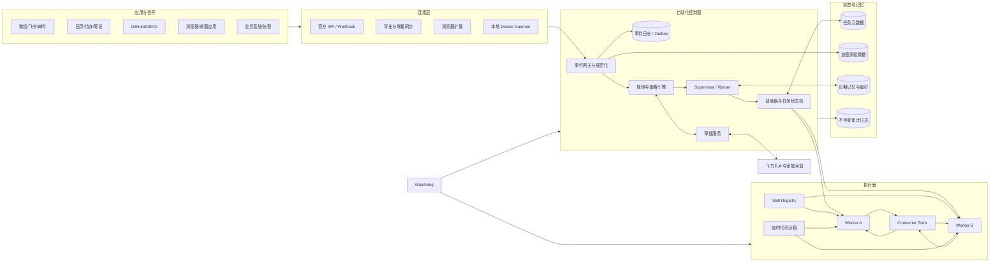
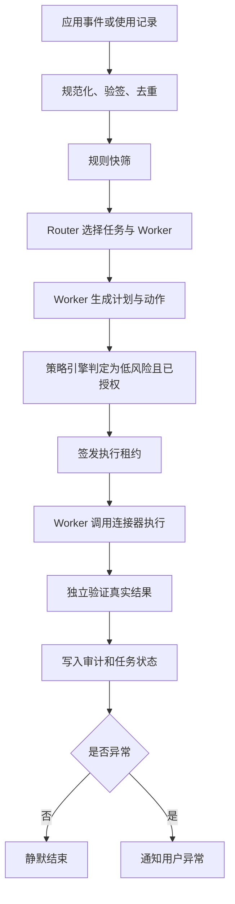
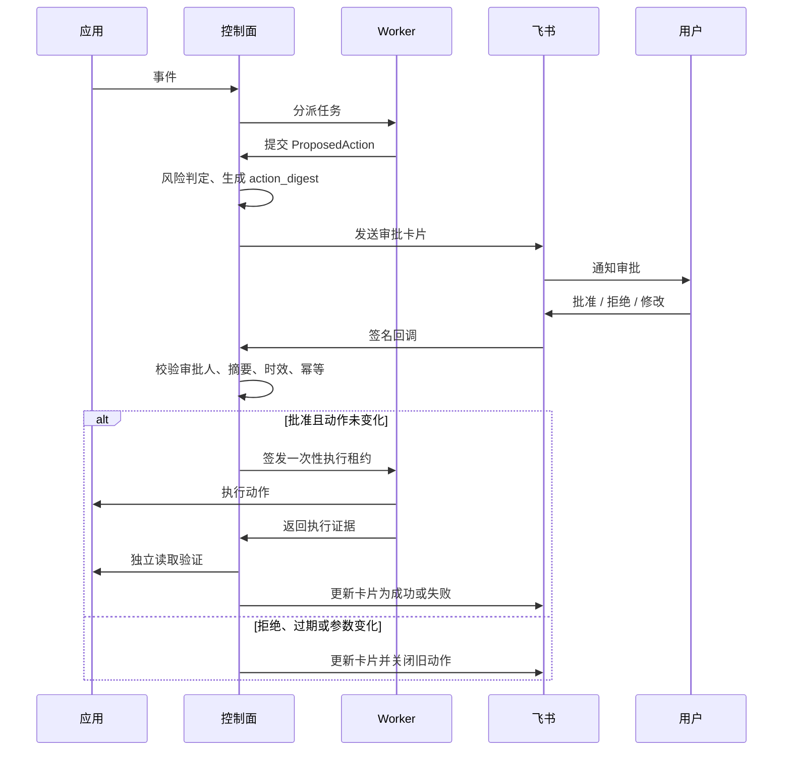

# 个人超级助理架构说明

> 文档状态：Draft v0.1  
> 更新时间：2026-11-16  
> 目标读者：产品、架构、客户端、服务端和 Agent 开发者

## 1. 结论

个人超级助理不是“一个更聪明的聊天窗口”，而是一套持续运行的 Agent 系统：

```text
应用使用记录 -> 统一事件 -> 规则与模型判断 -> 任务编排
             -> 低风险任务静默执行
             -> 高风险任务飞书审批 -> 执行 -> 验证 -> 记录
```

整体采用以下核心结构：

- 用户始终只面对一个连续的超级助理身份。
- 应用通过连接器贡献上下文和执行能力。
- 自动化中台负责统一事件、规则、调度、去重、审批和审计。
- Worker 负责在隔离的任务上下文中完成具体工作。
- 飞书只承担人工决策入口，不承担 Agent 推理。
- 执行后必须验证真实结果，不能把“命令返回成功”当成“任务已完成”。

本文从两套设计中选择性吸收以下内容：

| 来源 | 采用的部分 | 在本方案中的位置 |
| --- | --- | --- |
| Super-agent | 单一连续 Agent 身份、Router/Worker 分层、事件 Trigger、全双工交互、计算/状态/环境分离、Watchdog | 产品形态与 Agent 执行框架 |
| 卡兹克 Agent 自动化中台 | 统一事件格式、规则派活、去重、Agent 插件、单一通知出口、关键审批、任务留痕、自动交付和核实 | 自动化控制面、连接器体系和审批闭环 |

两套设计最重要的共同点，是把人的角色从“每一步操作的启动者和监督者”上移到“目标设定者、例外审批者和结果验收者”。

## 2. 目标与边界

### 2.1 目标

1. 汇总用户授权应用中的使用记录、任务、消息、日程和操作上下文。
2. 从应用信号和用户自然语言中识别可能需要处理的事情。
3. 对可逆、低风险、授权明确的任务进行静默执行。
4. 对删除、外发、付费、权限、凭据和不可逆操作发起飞书审批。
5. 所有动作可解释、可追溯、可撤销或可补偿。
6. Agent 在用户离线、设备休眠或任务长时间等待时仍能保持任务状态。
7. 连接器、Agent 和执行环境可插拔，避免绑定单一模型或应用。

### 2.2 非目标

- 不绕过应用授权、平台条款或用户明确设置。
- 不以截屏和读取全部本地数据作为默认接入方式。
- 不允许执行 Agent 自行修改自己的审批规则。
- 不把飞书“点击通过”当作对任意后续动作的长期授权。
- 首期不建设完整的多租户企业平台。
- 首期不承诺完全无人监督的财务或高风险账户操作。

## 3. 设计原则

### 3.1 事件优先，而非聊天优先

应用消息、日程到期、Issue、告警、文件变化、使用行为都可以变成 Trigger。聊天只是其中一种入口，不是系统唯一的启动方式。

### 3.2 一个身份，多个隐藏任务

用户看到的是一个持续存在的助理；系统内部可以同时运行多个 Worker。Worker 的任务会话是实现细节，不应成为用户管理上下文的负担。

### 3.3 控制面不能被执行面篡改

Worker 可以提出动作，但不能决定动作是否越过审批边界。规则版本、权限、审批签名和执行租约由控制面管理。

### 3.4 审批必须绑定具体动作

审批对象不是一句模糊的任务描述，而是目标应用、目标对象、参数、预期副作用、证据、过期时间和动作摘要。任何参数变化都会生成新的审批请求。

### 3.5 默认本地优先，最小权限

能通过官方 API 完成的操作优先使用 API。只有必须以用户当前登录态或本地环境完成的动作，才交给本地 Daemon。凭据不进入模型上下文。

### 3.6 至少一次接收，幂等执行

事件可以重复投递，业务副作用不能重复发生。每个事件和动作必须携带稳定的幂等键。

### 3.7 以结果而非日志验收

动作执行后要重新读取目标对象或使用独立探针确认结果。例如邮件要确认已发送记录存在，文件变更要确认目标版本和内容，系统发布要确认线上版本已生效。

### 3.8 连接器是插件，Skill 是 SOP

- 连接器负责协议、认证、能力声明和原始数据结构转换。
- Skill 负责某类任务的知识、步骤和成功标准。
- Worker 负责在两者之间进行推理与执行。

## 4. 总体架构



### 4.1 逻辑分层

| 层 | 职责 | 不负责 |
| --- | --- | --- |
| 应用连接层 | 认证、拉取记录、接收 Webhook、声明可执行动作 | 业务决策、审批判断 |
| 控制面 | 统一事件、路由、策略、审批、任务状态、调度、审计 | 长时间执行具体任务 |
| 执行面 | 推理、调用工具、运行 Skill、完成动作 | 改变审批边界、签发权限 |
| 状态层 | 保存任务、记忆、原始资料、审批和执行证据 | 直接对外执行动作 |
| 人机交互层 | 飞书通知、审批卡片、状态查询和人工接管 | 代替策略引擎给出最终授权 |

## 5. 核心组件

### 5.1 应用连接器

连接器分为四类：

1. **官方 API/Webhook**：优先方案，权限、速率和数据边界最清晰。
2. **增量导出/同步**：适用于提供数据导出但没有完整 API 的应用。
3. **浏览器扩展**：用户明确授权后采集页面上下文或执行页面操作。
4. **本地 Device Daemon**：用于只能通过桌面客户端、本地文件或用户登录态完成的任务。

每个连接器必须提供能力清单：

```yaml
connector: example-app
version: 1
auth:
  type: oauth2
  scopes:
    - records.read
    - messages.draft
capabilities:
  - id: records.read
    risk: read
    reversible: true
  - id: message.send
    risk: external_write
    reversible: false
limits:
  rate_limit: provider_defined
  data_retention: user_policy
```

连接器只能暴露实际获批的能力。未声明的能力不能被 Worker 通过通用调用绕过。

### 5.2 使用记录与统一事件

“使用记录”首先是证据，不是命令。系统把应用活动统一为 `UsageObservation`：

| 字段 | 含义 |
| --- | --- |
| `observation_id` | 稳定、唯一的数据标识 |
| `source` | 应用、账号、设备 |
| `occurred_at` | 原始发生时间 |
| `activity_type` | 阅读、编辑、发送、搜索、完成、告警等 |
| `subject` | 用户、项目、会话、文件、订单等对象 |
| `summary` | 可进入模型上下文的最小摘要 |
| `raw_ref` | 加密原文或原始记录的引用 |
| `sensitivity` | 公开、内部、私密、敏感凭据等 |
| `consent_scope` | 用户授权的用途和范围 |

原始记录默认留在加密对象存储或本地设备中。模型只按任务需要读取摘要，必要时通过受控工具按引用读取局部原文。

规范化事件 `Event` 再附加自动化语义：

```json
{
  "event_id": "evt_01J...",
  "idempotency_key": "source:account:object:version:event_type",
  "source": "calendar",
  "type": "event.upcoming",
  "subject": {"kind": "calendar_event", "id": "cal_123"},
  "occurred_at": "2026-11-16T09:00:00+08:00",
  "payload_ref": "raw://calendar/cal_123/v7",
  "sensitivity": "private",
  "trace_id": "tr_01J..."
}
```

事件网关负责：

- 验签和来源认证。
- 格式校验与字段规范化。
- 去重、乱序处理和版本冲突检测。
- 写入事件日志后再确认接收。
- 过滤噪声，只把候选事件送入规则或模型。

### 5.3 自动化中台与 Router

该组件兼具两种来源的职责：

- 像 Agent 中台一样，提供稳定、确定性的事件入口和调度。
- 像 Super-agent 的 Router 一样，维护全局用户状态，并把独立任务交给 Worker。

Router 不应亲自执行长任务。它负责：

- 维护当前用户的目标、偏好、权限和进行中的事项。
- 判断新事件是否值得行动。
- 将一个任务分派给独立 Worker。
- 处理跨任务冲突和用户新指令。
- 决定是否需要通知用户，但不自行绕过策略审批。

路由分两阶段：

1. **快路径**：确定性规则，例如来源、对象类型、时间、关键词、用户白名单和频率。
2. **慢路径**：仅对候选事件使用模型判断意图、上下文和置信度。

原始应用内容必须被标记为“资料”，优先级低于系统规则和用户直接指令，以降低提示词注入风险。

### 5.4 Worker

每个 Worker 只处理一个任务：

- 上下文隔离，避免不同任务互相污染。
- 加载该任务需要的 Skill 和最小工具集。
- 可运行在云端沙箱、用户设备或受控执行容器中。
- 不直接与用户争抢通知出口，所有对外通知由控制面统一处理。
- 每个动作都必须经过工具层能力检查。

复杂任务可以在 Worker 内再拆分 Subagent，但上层任务状态、支出上限、审批边界和审计记录仍由控制面统一管理。

### 5.5 策略引擎

策略引擎由代码、配置和可选模型共同组成，但最终授权结果必须以可审计的规则版本为准。

默认风险分级：

| 操作 | 默认处理 | 示例 |
| --- | --- | --- |
| 只读、搜索、总结 | 静默执行 | 读取日程、汇总使用记录 |
| 私有草稿、本地计算 | 静默执行 | 创建未发送邮件、生成待办草稿 |
| 可逆的私有写入 | 默认静默，可配置 | 写私人笔记、移动个人任务状态 |
| 共享范围内的写入 | 审批或预先白名单 | 修改共享文档、向群内发消息 |
| 对外发送 | 审批 | 发邮件、发微信、提交公开评论 |
| 财务与权限 | 强制审批 | 付费、续订、授权、共享密钥 |
| 删除、停服、不可逆 | 强制审批 | 删除数据、发布生产版本 |
| 低置信度、规则冲突 | 升级人工 | 无法确定对象或副作用的动作 |

强制审批不能被用户的自然语言、Skill 或 Worker 决策覆盖。用户可以预先配置低风险白名单，但规则更新本身也要留下版本和审计记录。

### 5.6 审批服务

审批服务采用“先准备、后审批、再执行”的三段式流程：

1. Worker 生成 `ProposedAction`，但不产生外部副作用。
2. 控制面渲染具体影响、目标和证据，生成不可变动作摘要。
3. 用户审批后，控制面签发一次性、短时效执行租约。

`ProposedAction` 至少包含：

```json
{
  "action_id": "act_01J...",
  "task_id": "task_01J...",
  "connector": "mail",
  "capability": "message.send",
  "target": {"account": "personal", "thread_id": "th_123"},
  "parameters": {
    "to": ["recipient@example.com"],
    "subject": "周末安排",
    "body_ref": "draft://mail/draft_456"
  },
  "side_effects": ["发送一封外部邮件"],
  "evidence_refs": ["observation://mail/msg_789"],
  "reversible": false,
  "risk": "external_write",
  "policy_version": "policy_2026_11_16_01",
  "expires_at": "2026-11-16T10:30:00+08:00"
}
```

审批记录必须绑定 `action_digest`，即动作规范化和参数哈希。以下情况需要重新审批：

- 收件人、目标对象、金额或权限发生变化。
- 正文或执行脚本发生实质变化。
- 审批过期。
- 执行环境与审批时声明的不一致。
- 同一审批被重复回调。

### 5.7 人工审批交互层

审批渠道通过 `ApprovalNotifier` 适配器接入。当前本地实现支持钉钉个人 A2UI
卡片和飞书适配器；钉钉渠道由独立 bridge 消费本机 `dws` 点击事件，不访问
SQLite，也不改变审批、租约和执行状态机。以下飞书流程仍可作为适配器规范示例。

飞书承担三个职责：

- 向用户发送需要判断的信息。
- 提供批准、拒绝和补充信息入口。
- 提供任务状态和审计查询入口。

审批卡片应优先展示：

- 一句话说明“准备做什么”。
- 由什么事件触发。
- 目标应用和对象。
- 精确副作用。
- 是否可撤销，以及如何撤销。
- 引用证据，不直接暴露不必要的私密原文。
- 动作摘要短码和过期时间。

飞书回调必须：

- 校验签名、时间戳和事件 ID。
- 校验点击者就是被授权审批人。
- 校验回调中的 `action_digest` 与当前待审批动作一致。
- 以幂等方式更新审批状态。
- 审批通过后只签发一次执行租约。

“修改后批准”不直接改写原动作，而是基于修改内容生成新动作和新摘要，再次进入审批。

### 5.8 状态、记忆与环境

三类数据分开存储：

| 类型 | 内容 | 生命周期 |
| --- | --- | --- |
| 全局记忆 | 用户偏好、长期目标、稳定事实、已批准规则 | 长期，可查看和删除 |
| 任务状态 | 当前计划、上下文、等待审批节点、执行进度 | 任务周期内，完成后按策略归档 |
| 原始应用数据 | 消息、文件、页面快照、使用日志 | 短周期或本地保存 |

执行环境和状态分离：

- 控制面可以常驻云端，不因个人设备休眠而停止。
- 需要在用户设备上完成的任务由 Paired Device Daemon 领取。
- Daemon 不保存长期会话状态，只执行受控命令和返回结果。
- 代码、浏览器和第三方工具在最小权限沙箱或受限执行环境中运行。

### 5.9 Watchdog

Watchdog 独立于主 Agent，负责：

- 检查 Worker 是否在实质推进，而非重复循环。
- 识别工具持续失败、上下文溢出和成本异常。
- 重试可恢复故障，终止不可恢复任务。
- 检查审批是否卡住、执行租约是否泄漏。
- 对关键状态进行对账，例如事件已接收但未进入任务、动作已执行但未验证。
- 在连续失败达到阈值时通知用户并提供人工接管入口。

## 6. 运行流程

### 6.1 无审批的静默执行



静默执行不表示没有记录。用户应能在统一时间线中看到“为什么触发、做了什么、结果如何、如何撤销”，只是不被迫在过程中审批。

### 6.2 需要审批的执行



### 6.3 动作状态机

```text
detected
  -> planned
  -> policy_evaluated
  -> auto_approved | approval_pending
  -> approved | denied | expired | superseded
  -> executing
  -> executed
  -> verified | verification_failed
  -> compensated | closed
```

每条状态迁移都应记录：

- 迁移前后的状态。
- 触发者，包括系统、Agent 或用户。
- 规则版本和模型版本。
- 时间、原因和关联证据。
- 幂等键和动作摘要。

## 7. 数据模型

| 实体 | 关键字段 | 说明 |
| --- | --- | --- |
| `SourceAccount` | `id`, `connector`, `scopes`, `device_id` | 用户授权的应用账号 |
| `UsageObservation` | `id`, `source`, `type`, `subject`, `summary`, `raw_ref` | 应用使用记录 |
| `Event` | `event_id`, `idempotency_key`, `payload_ref`, `trace_id` | 自动化输入 |
| `Task` | `task_id`, `goal`, `state`, `priority`, `deadline` | 面向用户的任务实体 |
| `PlanStep` | `step_id`, `task_id`, `state`, `constraints` | 任务步骤 |
| `ProposedAction` | `action_id`, `capability`, `target`, `params`, `digest` | 执行前的具体动作 |
| `ApprovalRequest` | `approval_id`, `action_digest`, `status`, `approver`, `expires_at` | 审批记录 |
| `ExecutionLease` | `lease_id`, `action_digest`, `worker_id`, `expires_at` | 一次性执行授权 |
| `ExecutionResult` | `lease_id`, `result_ref`, `receipt`, `error` | 执行证据 |
| `RuleVersion` | `version`, `rules`, `author`, `effective_at` | 可审计规则快照 |

事件日志和审计日志采用追加写入。任务表可以更新，但每次变化都要保留审计记录。外部副作用通过 Outbox + 执行回执实现可靠交付。

## 8. 权限与安全

### 8.1 权限模型

- 每个连接器单独授权，不共享万能 Token。
- Worker 只获得当前任务所需的最小能力租约。
- 能力租约绑定任务、目标、动作摘要和过期时间。
- 本地 Daemon 使用设备身份和短期证书，不把长期凭据写入模型上下文。
- 凭据由独立 Secret Store 管理，连接器在最后一跳注入。

### 8.2 数据保护

- 原始记录按敏感等级加密，默认只在本地或受控区域保存。
- 可进入模型上下文的摘要遵循最小必要原则。
- 日志默认脱敏，密钥、Cookie、私钥、支付信息和完整消息正文不进入普通日志。
- 支持按连接器、时间范围和数据类别删除。
- 清楚区分“为了完成任务读取”和“用于长期记忆”的授权。

### 8.3 Agent 安全

- 所有应用内容视为不可信数据，不作为高优先级指令。
- 工具调用经过 Schema 校验、目标校验和参数白名单。
- 网络出口按任务白名单限制。
- 高风险动作必须由控制面签发执行租约。
- 用户可随时启用全局 Kill Switch，暂停所有写入和自动化。
- 不允许多个平级 Agent 无上限互相唤醒，设置调用深度、预算和超时。

## 9. 可靠性设计

1. **事件幂等**：同一个来源事件只生成一次有效业务效果。
2. **至少一次投递**：接收事件后先持久化，再执行路由。
3. **执行租约**：一个已批准动作最多执行一次；重复执行必须产生新的动作和审批。
4. **结果验证**：执行 Worker 与验证逻辑尽量分离。
5. **失败复盘**：失败任务保留最后稳定状态和最小复现证据。
6. **人工接管**：长时间停滞或连续异常时，将任务转为暂停并生成飞书处理卡片。
7. **补偿优先**：可逆动作失败时尝试明确补偿；不可逆动作不允许自动猜测式重试。
8. **规则灰度**：新规则先对低风险来源或影子模式运行，再逐步启用。

## 10. 可观测性

建议提供个人可理解的“任务时间线”，同时保留工程指标：

| 指标 | 用途 |
| --- | --- |
| 事件接收量、去重量、丢弃原因 | 判断连接器和过滤规则质量 |
| 任务启动到完成的分位数耗时 | 发现系统瓶颈 |
| 自动执行率、审批率、拒绝率 | 评估信任阈值和规则设计 |
| 审批卡片到用户响应的耗时 | 判断通知时机和打扰程度 |
| 动作成功率、验证失败率、补偿率 | 监控执行质量 |
| 单任务模型与工具成本 | 控制预算和异常循环 |
| 连接器错误率与授权过期率 | 维持数据新鲜度 |
| Watchdog 告警和人工接管次数 | 发现长期可靠性问题 |

所有任务用 `trace_id` 贯穿事件、计划、审批、执行和验证，方便用户追问“这件事是谁在什么时候为什么做的”。

## 11. 建议部署形态

```text
云端控制面
  - API/Webhook 网关
  - 事件队列与事件日志
  - 规则、策略、Router、审批和调度服务
  - PostgreSQL：任务、审批、规则、租约
  - 加密对象存储：原始资料和证据
  - Secret Store：连接器凭据
  - 容器化 Worker 和临时代码沙箱

用户设备
  - Device Daemon
  - 本地文件、桌面应用和浏览器执行能力
  - 本地加密缓存

飞书
  - 自建应用/机器人
  - 审批卡片
  - 签名回调
```

技术选型可以替换，但边界应保持稳定：

- Worker 不直接长期持有全局状态。
- Device Daemon 不保存全局用户记忆。
- 审批服务不执行第三方动作。
- 飞书不是任务状态数据库，只展示和驱动状态迁移。
- 原始应用数据不默认进入长期记忆。

## 12. MVP 实施路线

### 阶段 1：可观察的只读助理

- 接入 2—3 个高价值应用：日历、邮件和 GitHub 或待办。
- 统一使用记录和事件格式。
- 生成每日摘要、待办候选和风险提示。
- 接入飞书卡片和完整审批回调链路。
- 暂不允许自动对外写入，只验证事件、规则和审计。

验收标准：

- 重复 Webhook 不产生重复任务。
- 每条自动结论能回溯到原始记录。
- 审批回调具备签名校验、过期和重放保护。
- 用户可以在一个时间线里看到全部任务。

### 阶段 2：低风险静默写入

- 开放私人笔记、个人待办和草稿类写入。
- 引入执行租约、结果验证和撤销入口。
- 建立连接器能力矩阵和规则配置界面。
- 引入 Watchdog、预算和调用深度限制。

验收标准：

- 同一动作重复投递只产生一次副作用。
- 所有外部动作先准备、后审批、再执行。
- 可逆动作能够撤销或补偿。
- 敏感凭据不出现在模型上下文和应用日志中。

### 阶段 3：跨应用主动协作

- Router 在多个应用之间维护连续任务。
- 支持长任务、设备不常在线、审批等待数天的恢复。
- 引入 Skill Registry 和任务模板。
- 逐步扩大已证明安全的静默执行白名单。
- 对跨应用冲突、成本异常和模型漂移进行长期评估。

## 13. 关键架构决策

| 决策 | 选择 | 原因 |
| --- | --- | --- |
| 用户交互单位 | 一个超级助理身份 | 保持连续上下文，隐藏 Worker 会话 |
| 任务推进方式 | 事件驱动 + 主动调度 | 不再依赖用户打开聊天窗口 |
| 控制与执行 | 严格分离 | 防止 Worker 自行扩大权限 |
| 审批对象 | 具体动作摘要 | 避免审批被替换或重放 |
| 默认数据位置 | 本地优先 | 降低应用凭据和隐私数据的集中风险 |
| 长任务架构 | 分离计算、状态和执行环境 | 支持离线、异步、审批等待和设备切换 |
| 连接器接入 | 插件化能力清单 | 易于扩展应用且可统一治理 |
| 结果确认 | 独立验证 | 防止“调用成功但业务未完成” |

## 14. 待确认问题

1. 首期接入哪些应用，是否支持仅本地读取而不同步原始正文。
2. 哪些内部写入可以被默认视为静默可逆操作。
3. 用户是否允许助理在夜间主动处理任务，以及可接受的打扰等级。
4. 长期记忆允许保存哪些类别，默认保留多久。
5. 飞书审批人是否只有本人，是否需要委托或紧急联系人机制。
6. 跨设备执行时，Device Daemon 的最低可信硬件和本地加密要求。
7. 预算上限、模型选择和单任务最大执行时长。
8. 对失败动作采用自动补偿、人工恢复还是仅记录异常。

## 15. 参考

- [Super-agent 设计探索：让 Agent 只有一个，Session 变成实现细节](https://www.airobotnews.com/posts/super-agent-architecture-deepseek-harness/)
- [折腾了整整 1 年，毫无保留地分享一下我这套 Agent 自动化系统（公开转载全文）](https://www.woshipm.com/ai/6487627.html)
