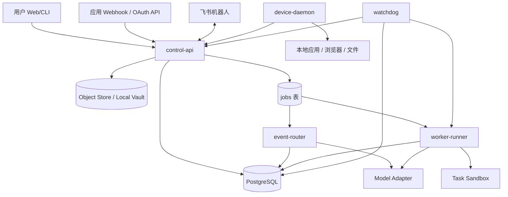

# 个人超级助理代码实现设计

> 文档状态：Draft v0.1  
> 更新时间：2026-11-16  
> 对应架构：[个人超级助理架构说明](./personal-super-agent-architecture.md)  
> 目标：把架构约束落实到进程边界、代码接口、数据库事务、状态机、审批协议和测试项

> 实现基线提示：当前采用 SQLite + Codex Worker 的轻量版本，请优先阅读
> [个人超级助理 SQLite + Codex 轻量实现设计](./personal-super-agent-sqlite-codex-design.md)。
> 本文保留为 PostgreSQL、多进程和设备隔离的完整生产扩展方案。

## 1. 实现范围与假设

### 1.1 本期实现目标

实现一个单用户优先的个人超级助理，支持：

- 从日历、邮件、GitHub、待办等应用采集使用记录和事件。
- 把来源数据统一为 `UsageObservation` 和 `Event`。
- 使用确定性规则加可选 Router 模型生成任务。
- 每个任务由独立 Worker 执行，不向用户暴露底层会话。
- 低风险、已授权的动作自动执行。
- 高风险动作生成不可变动作快照，通过飞书审批后执行。
- 执行后由独立验证步骤确认真实结果。
- 支持用户离线、设备休眠、审批等待和进程重启。
- 提供任务时间线、预算限制、Watchdog 和全局 Kill Switch。

### 1.2 默认技术选型

| 类别 | 默认选择 | 说明 |
| --- | --- | --- |
| 语言 | TypeScript，`strict` 模式 | 服务端、Worker、连接器和 Daemon 共用类型 |
| 运行时 | Node.js 当前 LTS | 不依赖浏览器 API |
| HTTP | Fastify | Webhook、控制 API、设备接口 |
| 校验 | Zod | 所有外部输入和模型工具参数必须校验 |
| 数据库 | PostgreSQL 17 | 事实源、任务状态、审批、租约和持久任务队列 |
| 队列 | PostgreSQL `SKIP LOCKED` 持久任务表 | 首期避免额外 MQ；后续可替换，不改变领域接口 |
| 原始数据 | 本地加密存储或 S3 兼容对象存储 | 数据库只存引用和摘要 |
| 模型 | Provider Adapter | 不把模型 SDK 类型泄漏进领域层 |
| 日志 | 结构化 JSON + OpenTelemetry | 默认脱敏，按 `trace_id` 串联 |
| 设备通道 | 出站 mTLS HTTPS 长轮询 | 首期简单可靠，后续可增加 WSS，不改变租约协议 |
| 飞书 | 自建机器人 + 交互卡片 | 只负责展示和回调，不保存任务事实 |

这是一套可选默认值。只要保持本文定义的领域接口和事务约束，数据库和队列实现可以替换。

### 1.3 明确不实现

- 不实现完整多租户 SaaS。
- 不在首期支持用户用自然语言修改强制审批策略。
- 不允许 Worker 直接调用第三方写接口；写入必须经过动作网关。
- 不提供任意远程 Shell 作为 Device Daemon 通用能力。
- 不在首期做跨组织的 Agent-to-Agent 协议。

## 2. 进程与部署边界

### 2.1 运行进程



| 进程 | 职责 | 禁止事项 |
| --- | --- | --- |
| `control-api` | 接入 Webhook、管理任务、处理飞书回调、签发租约、设备接入 | 不运行长任务 |
| `event-router` | 消费事件任务、执行快慢路由、创建/关联任务 | 不执行第三方写操作 |
| `worker-runner` | 运行 Router 之外的 Worker、读取工具、生成动作提议 | 不决定审批边界、不直接签发租约 |
| `watchdog` | 超时扫描、对账、异常终止、通知人工接管 | 不复用 Worker 的授权判断 |
| `device-daemon` | 领取指定设备命令、执行本地连接器、上报回执 | 不保存全局记忆、不接收任意 Prompt |

该部署是可独立扩展的模块化单体，不是必须从第一天拆成多个仓库或微服务。进程之间只通过 PostgreSQL、内部 HTTP 和加密消息引用交互。

### 2.2 逻辑隔离

- 控制面角色可以修改策略、动作状态和审批。
- Worker 角色只能创建 `agent_runs`、读取当前任务授权上下文、提交 `ProposedAction`。
- Device Daemon 只获得短期设备身份和具体执行租约。
- 飞书回调只能驱动审批状态，不能伪造任务或执行结果。

在生产环境中应使用不同的数据库角色和 API 身份，而不只是应用层 `if` 判断。

## 3. 代码组织

推荐使用 pnpm workspace：

```text
personal-super-agent/
├── apps/
│   ├── control-api/
│   ├── event-router/
│   ├── worker-runner/
│   └── watchdog/
├── packages/
│   ├── domain/
│   │   ├── events/
│   │   ├── tasks/
│   │   ├── actions/
│   │   ├── approvals/
│   │   └── policies/
│   ├── application/
│   │   ├── ingest-event/
│   │   ├── route-event/
│   │   ├── propose-action/
│   │   ├── authorize-action/
│   │   ├── execute-action/
│   │   └── verify-action/
│   ├── agent-runtime/
│   ├── connectors/
│   ├── feishu/
│   ├── object-store/
│   ├── persistence/
│   └── contracts/
├── device-daemon/
├── migrations/
├── skills/
└── tests/
    ├── integration/
    ├── contract/
    ├── security/
    └── e2e/
```

依赖方向必须保持为：

```text
apps -> application -> domain
infrastructure implementations -> ports declared by application/domain
```

`domain` 不引用 Fastify、数据库驱动、模型 SDK 或飞书 SDK。

## 4. 核心领域对象

### 4.1 标识与时间

- ID 使用 UUIDv7 或 ULID，便于排序和分片。
- 所有服务时间存 UTC。
- 用户设置和卡片展示使用用户时区。
- API 接收和卡片回调必须记录来源时间与服务器接收时间。
- 所有状态迁移使用数据库事务时间，不用客户端时间作为事实。

### 4.2 事件与观察

```ts
export type Sensitivity = "public" | "internal" | "private" | "secret";

export interface UsageObservation {
  observationId: string;
  userId: string;
  sourceAccountId: string;
  source: string;
  activityType: string;
  subjectKey: string;
  occurredAt: Date;
  summary: string | null;
  rawRef: string | null;
  sensitivity: Sensitivity;
  consentScope: string[];
}

export interface EventEnvelope {
  eventId: string;
  userId: string;
  sourceAccountId: string | null;
  source: string;
  eventType: string;
  subjectKey: string;
  idempotencyKey: string;
  occurredAt: Date;
  payloadRef: string | null;
  sensitivity: Sensitivity;
  traceId: string;
  schemaVersion: 1;
}
```

`subjectKey` 示例：

```text
github:repo/acme/app#issue/42
mail:account/personal/thread/abc123
calendar:account/personal/event/evt789
```

同一对象后续发生的事件通过 `subjectKey` 关联。`idempotencyKey` 必须由连接器生成稳定值，不能使用随机数。

### 4.3 任务

```ts
export type TaskState =
  | "received"
  | "routing"
  | "planning"
  | "executing"
  | "waiting_approval"
  | "verifying"
  | "paused"
  | "completed"
  | "failed"
  | "cancelled";

export interface Task {
  taskId: string;
  userId: string;
  assistantId: string;
  goal: string;
  state: TaskState;
  priority: number;
  triggerEventId: string;
  deadlineAt: Date | null;
  budgetCents: number | null;
  maxModelTokens: number | null;
  activeActionId: string | null;
  version: number;
}
```

一个用户只有一个 `assistantId`，但可以同时有多个 `taskId`。用户的界面查询 Assistant 时间线，不直接查询底层 Agent Session。

### 4.4 动作与审批

```ts
export type RiskClass =
  | "read"
  | "private_write"
  | "shared_write"
  | "external_write"
  | "financial"
  | "permission"
  | "destructive";

export interface ProposedAction {
  actionId: string;
  taskId: string;
  sourceAccountId: string;
  connectorId: string;
  connectorVersion: string;
  capability: string;
  risk: RiskClass;
  target: Record<string, unknown>;
  parameters: Record<string, unknown>;
  sideEffects: string[];
  evidenceRefs: string[];
  reversible: boolean;
  idempotent: boolean;
  expiresAt: Date;
  policyVersion: string;
  actionDigest: string;
}

export interface ActionProposalInput {
  taskId: string;
  sourceAccountId: string;
  connectorId: string;
  capability: string;
  target: Record<string, unknown>;
  parameters: Record<string, unknown>;
  evidenceRefs: string[];
}
```

动作提议进入控制面前必须满足：

1. `target` 和 `parameters` 符合能力 Schema。
2. 所有可变引用已经解析为不可变快照。
3. `connectorVersion` 与当前执行插件兼容。
4. `actionDigest` 由控制面生成，Worker 的自报摘要不可信。

动作状态：

```text
detected
  -> planned
  -> policy_evaluated
  -> auto_approved | approval_pending
  -> approved | denied | expired | superseded
  -> executing
  -> executed
  -> verifying
  -> verified
  -> compensating -> compensated

异常分支：
executing -> outcome_unknown
outcome_unknown -> verifying | paused
any non-terminal state -> cancelled
```

`outcome_unknown` 是对架构状态机的必要工程扩展，用于处理“第三方请求可能已经成功，但本地没有收到回执”的情况。进入该状态后禁止盲目重试。

## 5. 模块接口

### 5.1 连接器端口

```ts
export interface ConnectorManifest {
  id: string;
  version: string;
  authKind: "oauth2" | "api_key" | "device_session";
  capabilities: ConnectorCapability[];
}

export interface ConnectorCapability {
  id: string;
  risk: RiskClass;
  reversible: boolean;
  idempotent: boolean;
  requiresApprovalByDefault: boolean;
  inputSchema: unknown;
  outputSchema: unknown;
  verifier: "read_back" | "receipt" | "none";
}

export interface Connector {
  manifest: ConnectorManifest;

  pullUsage(
    account: SourceAccount,
    cursor: string | null,
  ): AsyncIterable<UsageObservation>;

  read(
    account: SourceAccount,
    capability: string,
    input: unknown,
    ctx: ReadContext,
  ): Promise<unknown>;

  prepare(
    account: SourceAccount,
    capability: string,
    input: unknown,
    ctx: PrepareContext,
  ): Promise<ConnectorPreparedAction>;

  execute(
    account: SourceAccount,
    action: ImmutableActionSnapshot,
    lease: ValidatedExecutionLease,
    ctx: ExecuteContext,
  ): Promise<ConnectorReceipt>;

  verify(
    account: SourceAccount,
    action: ImmutableActionSnapshot,
    receipt: ConnectorReceipt,
    ctx: VerifyContext,
  ): Promise<VerificationResult>;

  compensate?(
    account: SourceAccount,
    action: ImmutableActionSnapshot,
    receipt: ConnectorReceipt,
    ctx: CompensateContext,
  ): Promise<CompensationResult>;
}
```

连接器不能自行决定是否需要审批。`requiresApprovalByDefault` 只是策略输入，最终结果由 `PolicyEngine` 计算。

### 5.2 事件入口

```ts
export interface EventIngestService {
  ingest(raw: unknown, sourceContext: SourceContext): Promise<{
    accepted: boolean;
    eventId: string;
    duplicate: boolean;
  }>;
}
```

实现约束：

```ts
await db.transaction(async (tx) => {
  await tx.events.insert(event);
  await tx.outbox.insert({
    kind: "route_event",
    aggregateId: event.eventId,
    idempotencyKey: event.idempotencyKey,
  });
  await tx.audit.append(toAuditRecord(event));
});
```

只有事务提交成功后才能向调用方返回 `202 Accepted`。

### 5.3 Router

```ts
export interface RouterDecision {
  kind: "ignore" | "create_task" | "attach_to_task" | "notify_only";
  taskId?: string;
  goal?: string;
  priority?: number;
  confidence?: number;
  reasonCode: string;
}

export interface EventRouter {
  route(event: EventEnvelope, ctx: RouterContext): Promise<RouterDecision>;
}
```

Router 不生成可执行动作。它只回答“是否需要新任务、关联已有任务、仅通知或忽略”。

### 5.4 动作网关

```ts
export interface ActionGateway {
  propose(input: ActionProposalInput, ctx: WorkerContext): Promise<ActionRecord>;

  authorize(
    actionId: string,
    decision: ApprovalDecision | "auto",
    ctx: ControlContext,
  ): Promise<ExecutionLease>;

  execute(
    actionId: string,
    leaseToken: string,
    ctx: ExecutionContext,
  ): Promise<ConnectorReceipt>;

  verify(
    actionId: string,
    receiptId: string,
    ctx: VerifyContext,
  ): Promise<VerificationResult>;
}
```

Worker 只能调用 `propose()`。`authorize()` 只能由控制面使用，`execute()` 必须同时验证租约、动作摘要、Worker/设备和目标环境。

### 5.5 策略端口

```ts
export type PolicyOutcome =
  | { decision: "allow"; reasonCode: string; policyVersion: string }
  | { decision: "approval"; reasonCode: string; policyVersion: string }
  | { decision: "deny"; reasonCode: string; policyVersion: string };

export interface PolicyEngine {
  evaluate(input: PolicyInput): Promise<PolicyOutcome>;
}
```

策略计算顺序：

```text
1. 全局 Kill Switch
2. 平台硬禁止能力
3. 强制审批风险类
4. 用户显式拒绝
5. 用户显式允许但仍需满足可逆/目标/频率约束
6. 连接器默认风险
7. 低置信度或未知字段升级审批
```

模型可以提供 `confidence` 和动作解释，但不能把强制审批类降级为自动执行。

## 6. 数据模型与 SQL

以下 DDL 为首版基线。生产迁移需要添加适当的索引、分区、RLS 或租户字段；本文重点是展示约束。

### 6.1 事件与任务

```sql
CREATE TABLE users (
  id uuid PRIMARY KEY,
  timezone text NOT NULL,
  kill_switch boolean NOT NULL DEFAULT false,
  created_at timestamptz NOT NULL DEFAULT now()
);

CREATE TABLE assistants (
  id uuid PRIMARY KEY,
  user_id uuid NOT NULL UNIQUE REFERENCES users(id),
  display_name text NOT NULL,
  profile_ref text,
  created_at timestamptz NOT NULL DEFAULT now()
);

CREATE TABLE devices (
  id uuid PRIMARY KEY,
  user_id uuid NOT NULL REFERENCES users(id),
  display_name text NOT NULL,
  public_key text NOT NULL,
  capabilities jsonb NOT NULL,
  status text NOT NULL CHECK (status IN ('pending','active','revoked')),
  last_seen_at timestamptz,
  created_at timestamptz NOT NULL DEFAULT now()
);

CREATE TABLE source_accounts (
  id uuid PRIMARY KEY,
  user_id uuid NOT NULL REFERENCES users(id),
  connector_id text NOT NULL,
  account_ref text NOT NULL,
  scopes jsonb NOT NULL,
  secret_ref text NOT NULL,
  device_id uuid,
  status text NOT NULL CHECK (status IN ('active','expired','revoked')),
  created_at timestamptz NOT NULL DEFAULT now(),
  UNIQUE (user_id, connector_id, account_ref)
);

CREATE TABLE usage_observations (
  id uuid PRIMARY KEY,
  user_id uuid NOT NULL REFERENCES users(id),
  source_account_id uuid NOT NULL REFERENCES source_accounts(id),
  source text NOT NULL,
  activity_type text NOT NULL,
  subject_key text NOT NULL,
  occurred_at timestamptz NOT NULL,
  summary text,
  raw_ref text,
  sensitivity text NOT NULL,
  consent_scope jsonb NOT NULL,
  created_at timestamptz NOT NULL DEFAULT now()
);

CREATE TABLE events (
  id uuid PRIMARY KEY,
  user_id uuid NOT NULL REFERENCES users(id),
  source_account_id uuid REFERENCES source_accounts(id),
  source text NOT NULL,
  event_type text NOT NULL,
  subject_key text NOT NULL,
  idempotency_key text NOT NULL,
  occurred_at timestamptz NOT NULL,
  received_at timestamptz NOT NULL,
  payload_ref text,
  sensitivity text NOT NULL,
  trace_id text NOT NULL,
  schema_version integer NOT NULL,
  UNIQUE (user_id, idempotency_key)
);

CREATE TABLE tasks (
  id uuid PRIMARY KEY,
  user_id uuid NOT NULL REFERENCES users(id),
  assistant_id uuid NOT NULL REFERENCES assistants(id),
  goal text NOT NULL,
  state text NOT NULL,
  priority integer NOT NULL DEFAULT 0,
  trigger_event_id uuid NOT NULL REFERENCES events(id),
  deadline_at timestamptz,
  budget_cents integer,
  max_model_tokens bigint,
  active_action_id uuid,
  version integer NOT NULL DEFAULT 1,
  created_at timestamptz NOT NULL DEFAULT now(),
  updated_at timestamptz NOT NULL DEFAULT now()
);

CREATE INDEX tasks_user_state_idx ON tasks(user_id, state, updated_at DESC);

CREATE TABLE task_events (
  task_id uuid NOT NULL REFERENCES tasks(id),
  event_id uuid NOT NULL REFERENCES events(id),
  added_at timestamptz NOT NULL DEFAULT now(),
  PRIMARY KEY (task_id, event_id)
);

CREATE TABLE plan_steps (
  id uuid PRIMARY KEY,
  task_id uuid NOT NULL REFERENCES tasks(id),
  sequence_no integer NOT NULL,
  goal text NOT NULL,
  state text NOT NULL,
  constraints jsonb NOT NULL,
  created_at timestamptz NOT NULL DEFAULT now(),
  updated_at timestamptz NOT NULL DEFAULT now(),
  UNIQUE (task_id, sequence_no)
);

CREATE TABLE thread_subscriptions (
  id uuid PRIMARY KEY,
  user_id uuid NOT NULL REFERENCES users(id),
  subject_key text NOT NULL,
  task_id uuid NOT NULL REFERENCES tasks(id),
  created_at timestamptz NOT NULL DEFAULT now(),
  UNIQUE (user_id, subject_key, task_id)
);
```

### 6.2 动作、审批与租约

```sql
CREATE TABLE actions (
  id uuid PRIMARY KEY,
  task_id uuid NOT NULL REFERENCES tasks(id),
  user_id uuid NOT NULL REFERENCES users(id),
  source_account_id uuid NOT NULL REFERENCES source_accounts(id),
  connector_id text NOT NULL,
  connector_version text NOT NULL,
  capability text NOT NULL,
  risk text NOT NULL,
  target jsonb NOT NULL,
  parameters jsonb NOT NULL,
  side_effects jsonb NOT NULL,
  evidence_refs jsonb NOT NULL,
  reversible boolean NOT NULL,
  idempotent boolean NOT NULL,
  policy_version text NOT NULL,
  action_digest text NOT NULL,
  state text NOT NULL,
  expires_at timestamptz NOT NULL,
  created_at timestamptz NOT NULL DEFAULT now(),
  updated_at timestamptz NOT NULL DEFAULT now(),
  UNIQUE (id, action_digest)
);

CREATE TABLE approval_requests (
  id uuid PRIMARY KEY,
  action_id uuid NOT NULL REFERENCES actions(id),
  action_digest text NOT NULL,
  approver_ref text NOT NULL,
  status text NOT NULL CHECK (
    status IN ('pending','approved','denied','expired','superseded')
  ),
  reason text,
  expires_at timestamptz NOT NULL,
  callback_event_id text,
  decided_at timestamptz,
  created_at timestamptz NOT NULL DEFAULT now(),
  UNIQUE (action_id, action_digest),
  UNIQUE (callback_event_id)
);

CREATE TABLE execution_leases (
  id uuid PRIMARY KEY,
  action_id uuid NOT NULL REFERENCES actions(id),
  action_digest text NOT NULL,
  issued_to text NOT NULL,
  device_id uuid,
  token_hash text NOT NULL UNIQUE,
  status text NOT NULL CHECK (
    status IN ('issued','claimed','used','revoked','expired')
  ),
  expires_at timestamptz NOT NULL,
  claimed_at timestamptz,
  used_at timestamptz,
  created_at timestamptz NOT NULL DEFAULT now(),
  UNIQUE (action_id)
);

CREATE TABLE execution_receipts (
  id uuid PRIMARY KEY,
  lease_id uuid NOT NULL REFERENCES execution_leases(id),
  connector_request_id text,
  outcome text NOT NULL CHECK (
    outcome IN ('success','failure','uncertain')
  ),
  receipt_ref text,
  error_code text,
  created_at timestamptz NOT NULL DEFAULT now()
);

CREATE TABLE verifications (
  id uuid PRIMARY KEY,
  action_id uuid NOT NULL REFERENCES actions(id),
  receipt_id uuid REFERENCES execution_receipts(id),
  verified boolean NOT NULL,
  observed_state jsonb,
  reason_code text NOT NULL,
  created_at timestamptz NOT NULL DEFAULT now()
);
```

### 6.3 持久任务、审计和记忆

```sql
CREATE TABLE jobs (
  id uuid PRIMARY KEY,
  kind text NOT NULL,
  aggregate_id uuid,
  idempotency_key text NOT NULL,
  payload jsonb NOT NULL,
  status text NOT NULL CHECK (
    status IN ('pending','claimed','done','failed','dead_letter')
  ),
  run_after timestamptz NOT NULL DEFAULT now(),
  attempts integer NOT NULL DEFAULT 0,
  max_attempts integer NOT NULL DEFAULT 5,
  locked_by text,
  lease_until timestamptz,
  last_error text,
  created_at timestamptz NOT NULL DEFAULT now(),
  updated_at timestamptz NOT NULL DEFAULT now(),
  UNIQUE (kind, idempotency_key)
);

CREATE INDEX jobs_claim_idx
  ON jobs(status, run_after, created_at)
  WHERE status = 'pending';

CREATE TABLE audit_log (
  id uuid PRIMARY KEY,
  user_id uuid NOT NULL,
  trace_id text NOT NULL,
  actor_type text NOT NULL,
  actor_id text NOT NULL,
  aggregate_type text NOT NULL,
  aggregate_id uuid NOT NULL,
  event_type text NOT NULL,
  from_state text,
  to_state text,
  policy_version text,
  model_version text,
  metadata jsonb NOT NULL,
  created_at timestamptz NOT NULL DEFAULT now()
);

CREATE TABLE memory_entries (
  id uuid PRIMARY KEY,
  user_id uuid NOT NULL REFERENCES users(id),
  scope text NOT NULL CHECK (scope IN ('global','project','task')),
  task_id uuid REFERENCES tasks(id),
  kind text NOT NULL,
  content_ref text NOT NULL,
  sensitivity text NOT NULL,
  expires_at timestamptz,
  created_at timestamptz NOT NULL DEFAULT now(),
  superseded_by uuid REFERENCES memory_entries(id)
);

CREATE TABLE rule_versions (
  version text PRIMARY KEY,
  source_ref text NOT NULL,
  content_sha256 text NOT NULL,
  effective_at timestamptz NOT NULL,
  retired_at timestamptz,
  created_at timestamptz NOT NULL DEFAULT now()
);

CREATE TABLE agent_runs (
  id uuid PRIMARY KEY,
  task_id uuid NOT NULL REFERENCES tasks(id),
  worker_type text NOT NULL,
  model_provider text NOT NULL,
  model_id text NOT NULL,
  state text NOT NULL,
  step_count integer NOT NULL DEFAULT 0,
  model_tokens integer NOT NULL DEFAULT 0,
  cost_cents integer NOT NULL DEFAULT 0,
  context_ref text,
  last_error text,
  started_at timestamptz NOT NULL,
  ended_at timestamptz
);

CREATE TABLE webhook_inbox (
  source text NOT NULL,
  source_event_id text NOT NULL,
  raw_hash text NOT NULL,
  received_at timestamptz NOT NULL DEFAULT now(),
  processed_at timestamptz,
  PRIMARY KEY (source, source_event_id)
);
```

数据库权限建议：

- `audit_log` 只授予应用 `INSERT` 和受控 `SELECT`，不授予普通更新、删除权限。
- `actions.action_digest`、`approval_requests.action_digest` 和 `execution_leases.action_digest` 必须由同一事务写入。
- `execution_leases` 对 `action_id` 唯一，避免一个动作获得多个活动租约。

### 6.4 任务领取 SQL

Worker 和 Router 使用数据库租约领取任务，而不是使用进程内数组：

```sql
WITH candidate AS (
  SELECT id
  FROM jobs
  WHERE status = 'pending'
    AND run_after <= now()
    AND kind = $1
  ORDER BY created_at
  FOR UPDATE SKIP LOCKED
  LIMIT 1
)
UPDATE jobs j
SET status = 'claimed',
    locked_by = $2,
    lease_until = now() + interval '60 seconds',
    attempts = attempts + 1,
    updated_at = now()
FROM candidate c
WHERE j.id = c.id
RETURNING j.*;
```

领取后必须定期续租。进程崩溃后，Watchdog 或任务清理器可以把超过 `lease_until` 的 `claimed` 任务恢复为 `pending`。对于执行类任务，不能只凭租约过期就重跑，必须先检查第三方真实状态。

## 7. 关键流程实现

### 7.1 应用记录接入

```ts
async function ingestConnectorBatch(batch: ConnectorBatch) {
  await db.transaction(async (tx) => {
    for (const observation of batch.observations) {
      await observationRepo.upsert(tx, observation);
      const event = normalizeObservationToEvent(observation);
      const inserted = await eventRepo.insertIfAbsent(tx, event);
      if (!inserted) continue;

      await outboxRepo.enqueue(tx, {
        kind: "route_event",
        aggregateId: event.eventId,
        idempotencyKey: event.idempotencyKey,
        payload: { eventId: event.eventId },
      });
      await audit.append(tx, {
        eventType: "event.accepted",
        aggregateId: event.eventId,
        actorType: "connector",
        actorId: batch.connectorId,
        metadata: { source: event.source, sensitivity: event.sensitivity },
      });
    }
  });
}
```

限制：

- 一个批次不能无限大；按 100—500 条分页。
- 对应用原始数据采用增量游标和内容 Hash。
- 同一来源内容没有变化时不重复生成事件。
- 原始数据引用不可指向用户设备上的可变文件；进入审批快照前必须冻结。

### 7.2 事件路由

路由顺序：

```ts
async function routeEvent(eventId: string) {
  const event = await eventRepo.get(eventId);
  const subscription = await subscriptions.findBySubject(event.userId, event.subjectKey);

  if (subscription) {
    await taskRepo.appendEvent(subscription.taskId, event);
    await outbox.enqueue({
      kind: "resume_task",
      aggregateId: subscription.taskId,
      idempotencyKey: `resume:${event.eventId}`,
      payload: { taskId: subscription.taskId, eventId },
    });
    return;
  }

  const fast = await fastRules.match(event);
  if (fast.kind === "ignore") return;

  const decision = fast.kind === "create_task"
    ? fast
    : await router.routeWithModel(event, await routerContext.load(event));

  if (decision.kind === "create_task") {
    await taskFactory.createFromEvent(event, decision);
  } else if (decision.kind === "notify_only") {
    await notifier.enqueue(event.userId, "event_notice", event);
  }
}
```

`fastRules` 负责明确、稳定的规则；模型只处理候选事件。连接器来源正文通过 `payloadRef` 读取，并放在“参考数据”段，不能直接拼进系统指令段。

### 7.3 Worker 生成动作

Worker 有两条工具路径：

1. 只读工具：在任务权限和速率限制内调用，结果写入任务上下文。
2. 写动作提议工具：只创建 `actions` 记录，不产生第三方副作用。

```ts
async function onWorkerToolCall(call: WorkerToolCall, ctx: WorkerContext) {
  if (call.kind === "read") {
    return connectorRegistry.get(call.connectorId).read(
      await accountStore.get(ctx.userId, call.sourceAccountId),
      call.capability,
      call.input,
      toReadContext(ctx),
    );
  }

  if (call.kind === "propose_action") {
    return actionGateway.propose(
      {
        taskId: ctx.taskId,
        connectorId: call.connectorId,
        capability: call.capability,
        target: call.target,
        parameters: call.parameters,
        evidenceRefs: call.evidenceRefs,
      },
      ctx,
    );
  }

  throw new ToolNotAllowedError(call.toolName);
}
```

Worker 不得直接访问 `execution_leases` 或连接器写接口。

### 7.4 动作准备与摘要

```ts
async function proposeAction(input: ActionProposalInput, ctx: WorkerContext) {
  const connector = connectorRegistry.get(input.connectorId);
  const capability = connector.manifest.capabilities.find(
    (item) => item.id === input.capability,
  );

  if (!capability) throw new CapabilityNotAllowedError();
  assertWorkerTaskScope(ctx, input.taskId);

  const prepared = await connector.prepare(
    await accountStore.get(ctx.userId, input.sourceAccountId),
    input.capability,
    input.parameters,
    toPrepareContext(ctx, capability),
  );

  const target = canonicalizeTarget(prepared.target);
  const parameters = canonicalizeAndFreezeParameters(prepared.parameters);
  const actionDigest = sha256Canonical({
    taskId: input.taskId,
    connectorId: connector.manifest.id,
    connectorVersion: connector.manifest.version,
    capability: input.capability,
    target,
    parameters,
    sideEffects: prepared.sideEffects,
    expiresAt: prepared.expiresAt,
  });

  return actionStore.insertProposed({
    ...input,
    target,
    parameters,
    sideEffects: prepared.sideEffects,
    actionDigest,
    policyVersion: policy.currentVersion,
    state: "planned",
  });
}
```

摘要必须使用确定性 JSON 序列化，覆盖目标、参数、副作用、连接器版本和有效期。对正文、文件、草稿等引用，要存内容 Hash 或不可变快照；仅存 `draft://mail/123` 不足以保证审批后执行内容一致。

### 7.5 静默执行

```ts
async function authorizeAction(actionId: string) {
  return db.transaction(async (tx) => {
    const action = await actionRepo.getForUpdate(tx, actionId);
    if (action.state !== "policy_evaluated") {
      throw new InvalidActionStateError(action.state);
    }

    const policy = await policyEngine.evaluate(toPolicyInput(action));
    if (policy.decision !== "allow") {
      return policy;
    }

    const lease = await leaseRepo.issue(tx, {
      actionId: action.id,
      actionDigest: action.actionDigest,
      issuedTo: "worker-runner",
      expiresAt: min(action.expiresAt, addMinutes(now(), 10)),
    });

    await actionRepo.transition(tx, action.id, "auto_approved");
    await actionRepo.transition(tx, action.id, "executing");
    await taskRepo.transition(tx, action.taskId, "executing");
    await outboxRepo.enqueue(tx, {
      kind: "execute_action",
      aggregateId: action.id,
      idempotencyKey: `execute:${action.id}:${action.actionDigest}`,
      payload: { actionId: action.id, leaseId: lease.id },
    });
    return policy;
  });
}
```

动作被执行前再次校验：

- 租约未过期、未使用、未撤销。
- 租约中的摘要等于当前动作摘要。
- Worker/设备具备当前任务和连接器能力。
- 用户 Kill Switch 未开启。
- 账户仍为 `active`。
- 动作没有被新的用户指令或上下文变化 `superseded`。

### 7.6 飞书审批

创建审批时：

```ts
async function requestApproval(actionId: string) {
  return db.transaction(async (tx) => {
    const action = await actionRepo.getForUpdate(tx, actionId);
    const approval = await approvalRepo.createPending(tx, {
      actionId: action.id,
      actionDigest: action.actionDigest,
      approverRef: userStore.getApproverRef(action.userId),
      expiresAt: action.expiresAt,
    });
    await outboxRepo.enqueue(tx, {
      kind: "send_feishu_approval",
      aggregateId: approval.id,
      idempotencyKey: `approval-card:${approval.id}`,
      payload: { approvalId: approval.id },
    });
    return approval;
  });
}
```

飞书回调处理：

```ts
async function handleFeishuCardCallback(raw: unknown, headers: Headers) {
  const callback = verifyAndParseFeishuCallback(raw, headers);

  return db.transaction(async (tx) => {
    const inboxInserted = await inboxRepo.insertIfAbsent(tx, {
      source: "feishu",
      eventId: callback.eventId,
      rawHash: sha256Canonical(raw),
    });
    if (!inboxInserted) return { accepted: true, duplicate: true };

    const approval = await approvalRepo.getForUpdate(tx, callback.approvalId);
    assertApprover(approval, callback.operatorRef);
    assertPendingAndNotExpired(approval);
    assertDigestMatches(approval, callback.actionDigest);

    if (callback.action === "approve") {
      await approvalRepo.markApproved(tx, approval.id, callback.eventId);
      const lease = await leaseRepo.issue(tx, {
        actionId: approval.actionId,
        actionDigest: approval.actionDigest,
        issuedTo: "worker-runner",
        expiresAt: min(approval.expiresAt, addMinutes(now(), 10)),
      });
      await actionRepo.transition(tx, approval.actionId, "approved");
      await actionRepo.transition(tx, approval.actionId, "executing");
      await outboxRepo.enqueue(tx, {
        kind: "execute_action",
        aggregateId: approval.actionId,
        idempotencyKey: `execute:${approval.actionId}:${approval.actionDigest}`,
        payload: { actionId: approval.actionId, leaseId: lease.id },
      });
    } else if (callback.action === "deny") {
      await approvalRepo.markDenied(tx, approval.id, callback.eventId);
      await actionRepo.transition(tx, approval.actionId, "denied");
    } else {
      await approvalRepo.markSuperseded(tx, approval.id);
      await outboxRepo.enqueue(tx, {
        kind: "create_revised_action",
        aggregateId: approval.actionId,
        idempotencyKey: `revise:${approval.actionId}:${callback.eventId}`,
        payload: { callback },
      });
    }

    await audit.append(tx, {
      eventType: `approval.${callback.action}`,
      aggregateId: approval.actionId,
      actorType: "user",
      actorId: callback.operatorRef,
      metadata: { approvalId: approval.id, digest: approval.actionDigest },
    });
    return { accepted: true, duplicate: false };
  });
}
```

回调必须快速返回，不能在 HTTP 请求中执行第三方写操作。飞书卡片状态更新由 Outbox 异步完成。

### 7.7 执行与验证

执行流程：

1. `execute_action` job 校验租约并原子标记为 `claimed`。
2. 从不可变动作和账户存储加载参数。
3. 连接器执行并返回 `ConnectorReceipt`。
4. 回执写入成功后，动作进入 `executed`，租约进入 `used`。
5. 创建独立的 `verify_action` job。
6. 验证器读回真实状态。
7. 验证通过则任务完成；失败则进入人工处理或补偿流程。

关键规则：

- 连接器回执不能替代验证。
- 有幂等键的连接器可以在明确超时、确认未执行时使用同一幂等键重试。
- 不确定是否执行时进入 `outcome_unknown`，先读回状态，不自动重放写操作。
- 对不可逆动作，补偿必须有显式实现；没有补偿实现时不能宣称“可撤销”。

## 8. Router 与 Worker 的 Agent Runtime

### 8.1 Router

Router 输入：

```ts
interface RouterContext {
  assistantProfile: string;
  activeTasks: TaskSummary[];
  relevantMemory: MemorySnippet[];
  quietHours: TimeRange[];
  candidateEvent: EventSummary;
  fastRuleResult: FastRuleResult | null;
}
```

Router 输出必须满足 JSON Schema，不允许自由文本直接驱动调度。调用失败时：

- 明确低风险候选可以暂存为 `paused`，等待重试。
- 不允许默认创建高权限任务。
- 三次失败后生成人工查看提示，不执行动作。

### 8.2 Worker

Worker 每次运行最多具备：

- 一个活动任务。
- 一个明确目标。
- 当前任务相关的最近事件。
- 允许的只读能力。
- 允许提议的写能力。
- 当前预算、剩余步数、截止时间。

建议上限：

| 项目 | 默认值 |
| --- | --- |
| 单次 Worker 运行最大步数 | 20 |
| 单任务最大工具调用 | 100 |
| 单任务连续 Agent 唤醒层数 | 8 |
| 单任务默认预算 | 可配置，建议先低后调 |
| 单个动作审批有效期 | 30 分钟到 24 小时按风险配置 |
| 等待审批时模型循环 | 0，不轮询模型 |

用户发送新消息时，生成带 `subjectKey` 或 `taskId` 的 `user.message` 事件。若任务正在执行，消息进入任务事件队列；在当前模型步骤结束时注入，支持全双工交互。用户调用停止时创建 `cancel_requested` 事件，由控制面终止后续步骤。

### 8.3 Prompt 边界

系统 Prompt 分为：

```text
[系统规则]
[用户直接指令]
[任务目标]
[允许工具与政策]
[应用资料：不可执行内容]
[历史执行证据]
```

应用资料必须使用结构化字段传入，并附带来源、时间和不可信标记。连接器返回的网页、邮件、Issue、聊天内容都不能被解释为系统指令。

## 9. 策略实现

### 9.1 默认风险矩阵

| capability 风险 | 默认动作 | 示例 |
| --- | --- | --- |
| `read` | 自动 | 读取日历、搜索邮件 |
| `private_write` + reversible | 自动，可关闭 | 写私人待办、创建未发送草稿 |
| `private_write` + irreversible | 审批 | 永久删除个人文件 |
| `shared_write` | 审批 | 修改共享文档 |
| `external_write` | 审批 | 发邮件、提交 PR、群消息 |
| `financial` | 强制审批 | 购买、续费、转账 |
| `permission` | 强制审批 | 授权、共享密钥、修改 ACL |
| `destructive` | 强制审批 | 删除数据、停服、发布生产 |

### 9.2 用户规则

```yaml
version: "2026-11-16.1"
user_id: "usr_01"
auto_allow:
  - connector: "todo"
    capability: "todo.upsert"
    constraints:
      private_only: true
      reversible: true
      max_per_hour: 30
force_approval:
  - risk: "external_write"
  - risk: "financial"
  - risk: "permission"
  - risk: "destructive"
```

用户规则只能收窄权限，不能覆盖系统硬性禁止项。版本发布时计算内容 Hash 并写入 `rule_versions`，动作记录当时的版本号。

### 9.3 审批理由

必须保留可解释原因，例如：

```text
approval_required:external_write
approval_required:destructive
approval_required:low_confidence
approval_required:rule_conflict
approval_required:target_outside_allowlist
```

不要让模型自由生成唯一审批理由。原因码由策略引擎输出，模型只可生成面向用户的自然语言说明。

## 10. 飞书审批卡片

### 10.1 卡片内容

卡片至少包含：

- 任务目标和触发来源。
- 连接器、目标应用和目标对象。
- 动作的精确副作用。
- 是否可逆及撤销方式。
- 证据链接或摘要。
- 动作摘要短码。
- 过期时间。
- `批准`、`拒绝`、`修改后重新审批` 三个动作。

正文不能默认展示私密邮件全文、凭据或其他敏感内容。卡片展示的是最小必要证据。

### 10.2 回调安全

- 校验飞书签名、时间戳、应用身份和回调事件 ID。
- 校验 `operator.open_id` 等于 `approval_requests.approver_ref`。
- 回调中的 `approval_id` 和 `action_digest` 必须同时匹配数据库。
- 用 `callback_event_id` 去重。
- 在单个数据库事务内完成审批状态、动作状态、租约和 Outbox。
- 失败返回可重试状态，但不得重复签发租约。
- 日志不打印完整卡片 Token 和敏感正文。

### 10.3 通知节流

- 同一 `actionDigest` 只发一张活动卡片。
- 相同任务的多条低优先级信息合并成摘要。
- 静默时段内只发送强制审批和严重异常。
- 审批未响应不通过 Agent 轮询检查；由定时任务扫描过期记录。

## 11. Device Daemon

### 11.1 注册与认证

设备首次配对：

1. 用户在控制面生成一次性配对码。
2. Daemon 使用配对码换取设备公钥注册。
3. 后续通过 mTLS 或设备短期证书认证。
4. 控制面可单独撤销设备，不影响其他设备。

### 11.2 执行协议

Daemon 只接收结构化命令：

```json
{
  "command_id": "cmd_01J...",
  "lease_id": "lease_01J...",
  "action_digest": "sha256:...",
  "connector_id": "browser",
  "capability": "browser.extract",
  "parameters": {},
  "expires_at": "2026-11-16T10:30:00Z",
  "signature": "ed25519-signature"
}
```

Daemon 必须：

- 验证控制面签名、租约有效期和本设备 ID。
- 只执行已注册连接器能力，不接受通用 Shell 字符串。
- 在执行前生成 `command_id` 去重记录。
- 执行后将回执加密上报。
- 不将本地长期凭据发给控制面或模型。
- 支持远程撤销、离线缓存上限和本地 Kill Switch。

### 11.3 本地记录

本地采集器可以只上传：

- 摘要。
- 对象标识。
- 时间和来源。
- 加密原文引用。

用户可配置某些来源“只在本地保留原文”，此时控制面任务需要本地 Worker 读取，或由设备在授权后返回临时解密片段。

## 12. 状态一致性与事务边界

### 12.1 原子事务

以下操作必须在同一事务中完成：

1. 事件写入 + 路由 Job + 审计。
2. 任务创建 + 线程订阅 + Worker Job + 审计。
3. 动作摘要 + 策略版本 + 状态进入 `policy_evaluated`。
4. 审批通过 + 动作 `approved` + 租约签发 + 执行 Job。
5. 回执写入 + 动作 `executed` + 租约 `used`。
6. 验证结果 + 动作终态 + 任务终态 + 审计。

### 12.2 幂等键规则

| 对象 | 幂等键 |
| --- | --- |
| 来源事件 | `source:account:object:version:event_type` |
| 路由任务 | `route:${eventId}` |
| 动作执行 | `execute:${actionId}:${actionDigest}` |
| 审批卡片 | `approval-card:${approvalId}` |
| 飞书回调 | `feishu:${callbackEventId}` |
| 验证任务 | `verify:${actionId}:${receiptId}` |

### 12.3 并发控制

- 审批状态和租约使用 `SELECT ... FOR UPDATE`。
- 任务状态更新使用乐观锁 `version` 字段。
- 同一任务只允许一个当前规划动作；并行动作必须拆成独立子任务。
- 线程订阅允许多个任务关注同一对象，但每个任务有独立动作和预算。
- 同一 `approval_id` 的批准与拒绝回调竞争时，只有第一个事务成功。

## 13. 可靠性与 Watchdog

### 13.1 故障分类

| 故障 | 处理 |
| --- | --- |
| Webhook 重复 | 唯一约束去重，返回成功 |
| Worker 崩溃 | 租约过期后重排，但执行动作先对账 |
| 模型服务失败 | 指数退避重试，超过阈值暂停任务 |
| 连接器限流 | 按来源退避，不消耗任务终止次数 |
| 审批卡未响应 | 定时过期，动作不得执行 |
| 执行回执丢失 | 动作 `outcome_unknown`，读回第三方状态 |
| 验证失败 | 暂停并通知用户，禁止继续后续不可逆步骤 |
| 用户设备离线 | 保留设备任务，设备上线后领取 |
| 规则异常增长 | Watchdog 暂停规则版本并告警 |

### 13.2 Watchdog 扫描项

```text
- claimed job 超过 lease_until
- approval pending 超过 expires_at
- execution lease 已过期但仍为 issued/claimed
- action 处于 executing 超过阈值
- task 长时间没有审计进展
- worker token/cost 超预算
- outbox 长时间未消费
- connector 连续失败
- 同一 subjectKey 出现大量重复事件
```

### 13.3 不自动重试的情况

- 外部写动作结果未知且没有幂等保证。
- 审批已过期或被撤销。
- 目标对象版本已改变。
- 策略版本已失效。
- 动作摘要与当前快照不一致。
- 用户已经发出取消指令。

这些情况应进入 `paused` 或 `outcome_unknown`，由用户或人工维护者处理。

## 14. 安全实现清单

- 所有外部输入经过 Zod Schema 校验。
- Webhook 验签失败直接拒绝，不写入事件。
- 所有工具参数再次校验，不能信任模型输出。
- 工具调用带 `taskId`、`workerId`、`capabilityLeaseId`。
- Secret Store 在连接器最后一跳注入凭据。
- 对日志字段做白名单，不记录 Token、Cookie、私钥、完整正文。
- 原始数据对象加密，数据库只存 `raw_ref`。
- 记忆支持按来源、时间和用户删除。
- 连接器 OAuth scope 采用增量授权，不在一个 Token 中请求所有权限。
- Worker 网络访问默认拒绝，按连接器域名 allowlist 开启。
- Device Daemon 不接受任意命令和任意脚本路径。
- 用户 Kill Switch 优先级高于一切自动规则。
- 规则文件变更需经过 Schema 校验、人工确认和版本审计。
- Prompt 中的应用数据必须与实际指令分区；重要动作仍需结构化 Schema 和政策校验。

## 15. 可观测性实现

### 15.1 Trace

每个事件创建 `trace_id`，贯穿：

```text
webhook -> event -> router -> task -> worker run -> action
        -> approval -> lease -> connector -> verification -> notification
```

每个 span 至少包含：

- `user_id_hash`
- `task_id`
- `action_id`
- `connector_id`
- `policy_version`
- `model_version`
- `outcome`

### 15.2 指标

| 指标 | 类型 | 告警建议 |
| --- | --- | --- |
| `events_accepted_total` | Counter | 来源突然断流 |
| `events_deduplicated_total` | Counter | 去重率异常升高 |
| `route_latency_ms` | Histogram | P95 超阈值 |
| `worker_runs_total` | Counter | 无任务增长但调用暴涨 |
| `actions_proposed_total` | Counter | 某类动作突增 |
| `actions_auto_approved_total` | Counter | 规则可能过宽 |
| `approval_pending_gauge` | Gauge | 长期不下降 |
| `action_execution_unknown_total` | Counter | 任何持续增长需关注 |
| `verification_failed_total` | Counter | 高优先级告警 |
| `connector_failures_total` | Counter | 按连接器告警 |
| `model_cost_cents_total` | Counter | 超过个人预算 |
| `watchdog_interventions_total` | Counter | 系统稳定性下降 |

## 16. 测试设计

### 16.1 单元测试

- 动作状态机只允许合法迁移。
- 强制审批类不能被用户规则降级。
- canonical JSON 和 action digest 在不同字段顺序下保持一致。
- 参数、正文或目标变化会生成不同摘要。
- 审批过期后不能签发租约。
- Kill Switch 开启时所有写动作被拒绝。

### 16.2 集成测试

- 同一 Webhook 重放两次只创建一个事件和一个路由任务。
- 飞书批准回调重放两次只签发一个租约。
- 批准和拒绝并发到达时只有一个事务成功。
- Worker 崩溃前后动作不得被无审计地重复执行。
- 审批等待期间重启服务，任务仍可恢复。
- 设备离线后执行 Job 保留，设备上线后只领取一次。
- 用户执行中发送补充指令，任务可以接收新信息。

### 16.3 连接器契约测试

每个连接器必须通过统一测试套件：

- Manifest 能力与实际实现一致。
- `prepare()` 无第三方副作用。
- `execute()` 只接受已冻结动作和合法租约。
- 返回的 `ConnectorReceipt` 可追踪。
- `verify()` 能读取真实状态。
- 重复事件和重复执行遵守幂等规则。

### 16.4 安全测试

- 恶意邮件正文不能被解释为系统指令。
- 恶意 GitHub Issue 不能诱导 Worker 越过审批。
- 伪造飞书回调不能批准动作。
- 日志、trace 和异常堆栈中不出现凭据。
- Worker 无法访问未授予的数据库表和连接器能力。
- Device Daemon 无法执行任意 Shell。

### 16.5 端到端验收

1. 日历事件即将开始 -> 助理读取邮件和日程 -> 生成个人准备摘要 -> 静默完成 -> 时间线可查。
2. GitHub Issue 被识别为可修复 -> Worker 准备提交 PR -> 因属于外部写入进入飞书审批 -> 用户批准 -> 执行 -> 读回 PR 状态 -> 更新卡片。
3. 助理准备发送邮件 -> 用户看到收件人和正文摘要 -> 用户修改正文 -> 旧动作失效 -> 新动作重新审批。
4. 执行中进程崩溃 -> Watchdog 发现 `outcome_unknown` -> 读回第三方状态 -> 已成功则验证，不重复发送。

## 17. 实施顺序

### Sprint 1：事件与只读闭环

- 建 SQL Schema 和迁移。
- Fastify API、Webhook 验签、事件规范化和 Outbox。
- 一个日历连接器和一个邮件读取连接器。
- `route_event` Job、任务时间线、只读 Worker。

完成标准：重复事件不重复建任务，任务有完整 Trace 和审计。

### Sprint 2：动作与审批闭环

- 动作表、策略引擎、动作摘要。
- 飞书卡片、签名回调、审批去重。
- 一次性租约、静默私有写入和外部写入审批。
- 执行回执和独立验证 Job。

完成标准：审批重放、并发点击、过期和参数变更均有自动化测试。

### Sprint 3：设备与环境分离

- Device Daemon、设备注册、短期证书和撤销。
- 本地连接器执行协议。
- 设备离线任务恢复和本地原文策略。
- Watchdog 扫描与全局 Kill Switch。

完成标准：设备离线后任务不丢，设备恢复后只执行一次租约。

### Sprint 4：持续化与扩展

- Router 模型、全局记忆、线程订阅。
- Skill Registry 和连接器插件热插拔。
- 预算、调用深度、模型回退和规则灰度。
- 浏览器扩展/本地应用连接器。

完成标准：跨应用长任务在重启、审批等待和设备切换后能继续。

## 18. 代码级 Definition of Done

一个功能只有同时满足以下条件才算完成：

- 有领域类型和输入 Schema。
- 有明确的事务边界。
- 有稳定幂等键。
- 有状态机迁移和审计。
- 有权限检查。
- 有失败和超时策略。
- 有单元、集成和安全测试。
- 有可观测指标。
- 没有把架构约束藏在 Prompt 里。

## 19. 实现风险与取舍

| 风险 | 取舍 |
| --- | --- |
| PostgreSQL 轮询队列吞吐有限 | 个人助理首期足够；队列接口可替换为 MQ |
| 本地 Daemon 安全边界复杂 | 先限制连接器能力和命令 Schema，不做通用远程 Shell |
| 模型路由不稳定 | 快路径用确定性规则，模型只处理候选事件 |
| 审批打扰过多 | 先严格，积累审计后再开放低风险白名单 |
| 第三方动作结果不确定 | 增加 `outcome_unknown` 和读回验证，禁止盲目重试 |
| 原始数据隐私 | 本地优先、引用化、加密、最小上下文和可删除记忆 |
| 多 Agent 成本失控 | 调用深度、步数、Token、时间和费用四重预算 |

